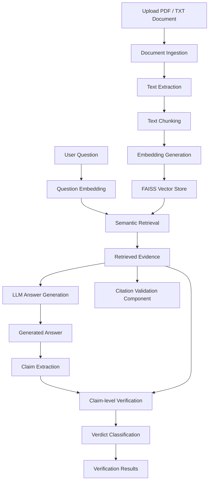

# Hallucination & Citation Verification Framework for RAG Applications

<p align="center">
  <strong>Making AI-generated answers more reliable through evidence-based verification.</strong>
</p>

<p align="center">
  
  
  
  
  
  
</p>

---

## Overview

Large Language Models (LLMs) can generate convincing answers containing inaccurate, unsupported, or hallucinated information, even when connected to external knowledge sources.

This project aims to address that problem by developing a **Hallucination and Citation Verification Framework for Retrieval-Augmented Generation (RAG) applications**.

Instead of simply generating an answer, the framework examines its individual factual claims and evaluates whether they are supported by the retrieved document evidence.

The system is designed to distinguish between:

- **SUPPORTED:** The available evidence directly supports the claim.
- **CONTRADICTED:** The available evidence directly conflicts with the claim.
- **INSUFFICIENT EVIDENCE:** The available evidence is not sufficient to determine whether the claim is correct.

The objective is to make AI-generated responses more transparent, traceable, and trustworthy.

## Key Features

- **Document Ingestion:** Upload PDF and TXT documents as knowledge sources.
- **Text Chunking:** Split documents into smaller overlapping text segments.
- **Semantic Embeddings:** Convert text chunks into numerical vector representations.
- **Vector Search:** Retrieve relevant document passages using FAISS.
- **RAG-based Answer Generation:** Generate answers using retrieved document context.
- **Claim Extraction:** Break generated responses into independently verifiable factual claims.
- **Claim-level Verification:** Evaluate individual claims against retrieved evidence.
- **Citation Validation Component:** Check whether cited source and page references correspond to retrieved document chunks.
- **Verdict Classification:** Categorize claims as Supported, Contradicted, or Insufficient Evidence.

## System Architecture

The following diagram illustrates the intended processing pipeline:



## How It Works

The framework follows a multi-stage verification process.

### 1. Document Ingestion

The user uploads a PDF or TXT document. The system extracts its text while preserving page-level information for PDF documents.

### 2. Text Chunking

Extracted text is divided into smaller, overlapping chunks.

Overlapping chunks help preserve contextual information that might otherwise be lost when text is split.

### 3. Embedding Generation

Each chunk is converted into a numerical vector using the `all-MiniLM-L6-v2` embedding model.

These vectors represent the semantic meaning of the text and enable similarity-based retrieval.

### 4. Semantic Retrieval

FAISS is used to search the vector store and retrieve the most relevant document chunks based on the user's question.

### 5. Answer Generation

The retrieved passages are supplied as context to the Gemini model.

The model is instructed to answer using the available evidence and acknowledge when the evidence is insufficient.

### 6. Claim Extraction

The generated answer is passed through a claim extraction stage.

The answer is separated into individual factual statements so that each claim can be evaluated independently.

### 7. Claim Verification

Each extracted claim is compared against the retrieved evidence.

The verification model assigns one of three verdicts:

| Verdict | Meaning |
|---|---|
| SUPPORTED | Evidence directly supports the claim. |
| CONTRADICTED | Evidence directly conflicts with the claim. |
| INSUFFICIENT_EVIDENCE | Evidence does not provide enough information to decide. |

An important distinction: a claim that is not supported by the retrieved evidence is not automatically false.

### 8. Citation Validation

A separate citation validation component checks whether a cited source and page reference exist among the retrieved chunks.

Semantic citation-support verification and full citation integration are planned extensions of this component.

---
## Application Preview

<p align="center">
  
</p>

<p align="center">
  <em>Document upload and question interface built with Streamlit.</em>
</p>

<p align="center">
  
</p>

<p align="center">
  <em>Generated answer with claim-level evidence verification and verdict classification.</em>
</p>
---

## Technology Stack

| Technology | Purpose |
|---|---|
| Python | Core development |
| Streamlit | Interactive application interface |
| PyMuPDF | PDF text extraction |
| Sentence Transformers | Text embeddings |
| FAISS | Vector similarity search |
| Google Gemini API | Answer generation, claim extraction, and verification |
| python-dotenv | Environment variable management |

## Project Structure

```text
hallucination-citation-verification/
│
├── data/
│   └── raw/
│       └── sample.pdf
│
├── src/
│   ├── ingestion.py
│   ├── chunking.py
│   ├── embeddings.py
│   ├── vector_store.py
│   ├── rag.py
│   ├── generation.py
│   ├── claim_extraction.py
│   ├── verification.py
│   ├── citation_validation.py
│   └── pipeline.py
│
├── tests/
│
├── reports/
│
├── app.py
├── requirements.txt
├── .gitignore
├── README.md
└── .env
```

## Installation and Setup

### 1. Clone the repository

```bash
git clone https://github.com/ianusha08/hallucination-citation-verification.git
```

### 2. Navigate to the project directory

```bash
cd hallucination-citation-verification
```

### 3. Create a virtual environment

```bash
python -m venv venv
```

Activate it on Windows:

```powershell
.\venv\Scripts\Activate.ps1
```

### 4. Install dependencies

```bash
pip install -r requirements.txt
```

### 5. Configure environment variables

Create a `.env` file in the project root:

```env
GEMINI_API_KEY=your_api_key_here
GEMINI_MODEL=your_supported_gemini_model
```

Replace the placeholders with your own Gemini API credentials and supported model name.

**Important:** Never commit your `.env` file or expose your API key publicly.

### 6. Run the application

```bash
streamlit run app.py
```

The application will open in your browser, normally at:

```text
http://localhost:8501
```

---

## Development Roadmap

This project is being developed incrementally, with an emphasis on building and evaluating each component.

- [x] Python environment and project structure
- [x] PDF and TXT document ingestion
- [x] Text chunking with overlap
- [x] Embedding generation
- [x] FAISS vector store and semantic retrieval
- [x] RAG-based answer generation
- [x] Claim extraction
- [x] Initial claim verification implementation
- [x] Basic Streamlit interface
- [x] Initial citation validation component
- [ ] Integrate citation extraction and validation into the complete pipeline
- [ ] Improve semantic evidence verification
- [ ] Add confidence scoring and verification metrics
- [ ] Evaluate performance using test datasets
- [ ] Improve interface and result visualization
- [ ] Add comprehensive automated tests

## Research Direction

Beyond implementation, the project aims to explore an important question:

**How can we determine whether individual statements in an LLM-generated answer are actually supported by the documents used to generate that answer?**

Potential areas of further investigation include:

- Claim decomposition and atomicity.
- Evidence retrieval quality and relevance.
- Entailment-based factual verification.
- Detection of contradictory evidence.
- Citation correctness and traceability.
- Reliability and evaluation of LLM-based verification.

The long-term goal is to develop a framework that does not simply generate answers, but also provides evidence-based assessments of their factual reliability.

## Current Project Status

The initial RAG and claim-verification pipeline has been implemented, and its core components have been tested individually.

Development is ongoing, particularly around integrated citation verification, evaluation, and improving the reliability of claim-level assessments.

---
